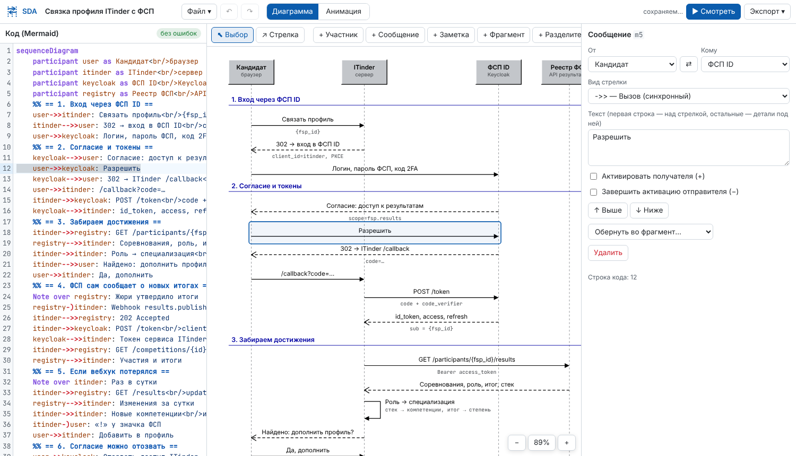
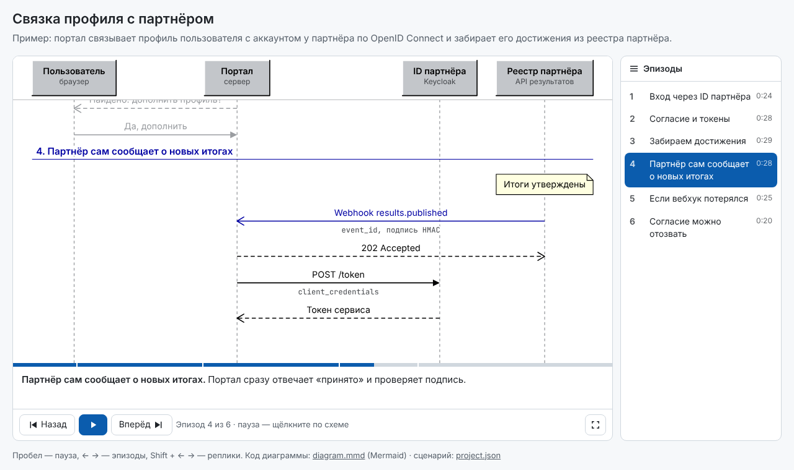
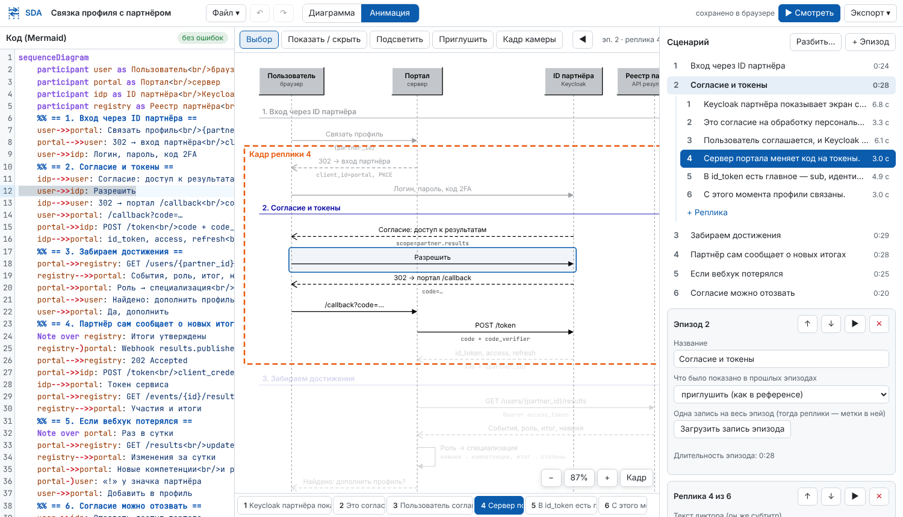

# Sequence Diagram Animator

Редактор UML-диаграмм последовательности. Диаграмму можно писать кодом
(синтаксис Mermaid) и собирать мышью, а потом превратить в анимированную
презентацию с озвучкой. Анимация делится на эпизоды и реплики; для каждой
реплики задаётся, какие элементы диаграммы показаны, какие подсвечены и какую
часть схемы видит камера. Готовую презентацию можно выгрузить в видео
(MP4/WebM) или в web-приложение, в котором, как в референсе, переключаются
эпизоды. Web-приложение публикуется в репозиторий GitHub вместе с workflow для
GitHub Pages.



## Содержание

- [Поиск готового решения](#поиск-готового-решения)
- [Референс: модуль ФСП в ITinder](#референс-модуль-фсп-в-itinder)
- [Что умеет редактор](#что-умеет-редактор)
- [Быстрый старт](#быстрый-старт)
- [Как устроена анимация](#как-устроена-анимация)
- [Код диаграммы](#код-диаграммы)
- [Экспорт](#экспорт)
- [Архитектура](#архитектура)
- [Тесты](#тесты)
- [Ограничения](#ограничения)

## Поиск готового решения

Нужен был инструмент с открытым кодом, в котором с моделью можно работать и
кодом, и визуально. Найденные варианты:

| Инструмент | Лицензия | Код | Визуально | Что важно |
| --- | --- | --- | --- | --- |
| [Mermaid](https://github.com/mermaid-js/mermaid) | MIT | да | нет | Стандарт «диаграмм как кода»: GitHub, GitLab, Notion и Obsidian рисуют его сами. Для диаграмм последовательности визуального редактора с открытым кодом нет (Mermaid Chart платный) |
| [PlantUML](https://github.com/plantuml/plantuml) | GPL-3.0, есть сборки MIT, Apache, LGPL и EPL | да | нет | Самый полный UML, но работает на Java и рисует на сервере |
| [ZenUML](https://github.com/mermaid-js/zenuml-core) | MIT | да | нет | Свой синтаксис, рендер на React. Развивается, но правка идёт только через текст |
| [SequenceDiagram (svg-sequence-diagram)](https://github.com/davidje13/SequenceDiagram) | LGPL-3.0 | да | нет | Онлайн-редактор со своим синтаксисом. Последний релиз вышел в 2023 году |
| [D2](https://github.com/terrastruct/d2) | MPL-2.0 | да | нет | Есть фигура `sequence_diagram` и пошаговые сценарии (анимированный SVG). Визуальный D2 Studio платный |
| [draw.io / diagrams.net](https://github.com/jgraph/drawio) | Apache-2.0 | только разовый импорт Mermaid и PlantUML | да | Рисование мышью. Обратной связи с кодом нет |
| [Gaphor](https://github.com/gaphor/gaphor) | Apache-2.0 | Python API, Jupyter | да | Настоящий UML-моделлер, где модель правят и кодом, и мышью. Но это десктопное приложение (GTK), без анимации и без веба |
| Modelio / Eclipse Papyrus | GPL-3.0 / EPL-2.0 | скрипты (Jython / Java) | да | Тяжёлые десктопные моделлеры |
| UMLet / UMLetino | GPL-3.0 | свойства элемента пишутся текстом | да | Диаграмма последовательности — один элемент, текст которого задаёт всю диаграмму |
| [sequencediagram.org](https://sequencediagram.org) | закрытый | да | да | Сочетает код и мышь лучше всех, но открытого кода нет |

**Вывод.** Веб-инструмента с открытым кодом, где диаграмма последовательности
синхронно правится и кодом, и мышью, в готовом виде нет. Gaphor, Modelio и
Papyrus сочетают оба способа, но это десктопные моделлеры без анимации и без
веб-экспорта. Поэтому за основу взят **Mermaid** как стандартный язык с
открытым кодом. Этот проект добавляет к нему то, чего в Mermaid нет:

- визуальный редактор, синхронный с кодом в обе стороны;
- слой анимации по эпизодам и репликам;
- экспорт в видео и в web-приложение.

Код, который пишет редактор, остаётся корректным Mermaid. Это проверяют тесты
настоящим парсером Mermaid 12 (`tests/mermaid-compat.test.ts`), поэтому ту же
диаграмму можно вставить в README на GitHub.

## Референс: модуль ФСП в ITinder

В [Evsikoff/itinder](https://github.com/Evsikoff/itinder) есть выдуманная
интеграция ITinder с ФСП:

- `portfolio-inner-site/src/components/applications/FspSequence.tsx` — диаграмма
  последовательности, которая рисуется кодом;
- `app/assets/presentation/fsp_link/scenes.json` — сценарий: 4 участника
  (Кандидат, ITinder, ФСП ID/Keycloak, Реестр ФСП) и 6 сцен;
- `app/assets/presentation/fsp_link/*.mp3` — записи диктора, по одной на сцену.

Пока говорит диктор, стрелки сцены прорисовываются по очереди. Прошлые сцены
остаются выше серыми, схема прокручивается за последней стрелкой, шапка с
участниками закреплена. Щелчок по схеме и пробел ставят на паузу, ← → и кнопки
«Назад» / «Вперёд» переключают сцены.

Здесь то же самое сделано общим инструментом. Демо-проект повторяет сценарий
референса, но с абстрактными участниками: Пользователь, Портал, ID партнёра
(Keycloak) и Реестр партнёра. Сценарий лежит в `examples/partner-link-scenes.json`
(тот же формат `scenes.json`), из него собирается
`public/examples/partner-link/project.json`. Записи диктора лежат рядом с
проектом: `01-vhod.mp3` … `06-otzyv.mp3`. Сборка (`npm run build`, а значит и
деплой на Pages) пересобирает пример сама и подхватывает записи; эпизод без
записи идёт в темпе чтения текста. Вручную — `npm run example`. Открыть демо в редакторе: **Файл → Пример: связка профиля с
партнёром** или `?example=demo` в адресе.

| В референсе | Здесь |
| --- | --- |
| Сцена со своим текстом и mp3 | Эпизод: одна запись на эпизод, реплики — метки внутри неё. Или своя запись у каждой реплики |
| Стрелки сцены появляются по ходу речи (доля `0.03 + 0.82·i/(n−1)`) | Новые элементы реплики появляются по очереди по той же формуле, можно и разом |
| Прошлые сцены серые | Начало эпизода «приглушить прошлое». Плюс ручное приглушение любого элемента в любой реплике |
| Прокрутка за последней стрелкой | Камера «авто». Есть ещё режимы «вписать элементы», «кадр вручную», «вся диаграмма» и «как в прошлой реплике» |
| Закреплённая шапка участников | Настройка `stickyHeader` |
| Нет записи — темп чтения 14 символов/с | То же (`readingSpeed`, `minReplica`) |
| Пауза, ← →, «Назад» / «Вперёд» | То же, плюс список эпизодов, Shift + ← → по репликам и перемотка по шкале |
| Диаграмма захардкожена в JSON | Код Mermaid, который правится и кодом, и мышью |



## Что умеет редактор

**Диаграмма: код и визуально.**

- Код Mermaid с подсветкой синтаксиса и строками ошибок (CodeMirror 6).
- Холст: щелчок выделяет элемент и его строку в коде. Курсор в коде, в свою
  очередь, выделяет элемент на схеме.
- Двойной щелчок по элементу правит подпись прямо на схеме.
- Плашки участников и строки (сообщения, заметки, фрагменты) перетаскиваются
  мышью.
- Инструмент **«Стрелка»**: протяните сообщение от одной линии жизни к другой.
  К той же линии получается вызов самого себя.
- Кнопки «+ Участник», «+ Сообщение», «+ Заметка», «+ Фрагмент»
  (обернуть выделенное в `alt`/`loop`/`opt`/…), «+ Разделитель».
- Панель свойств: подпись, вид участника (actor, database, boundary, control,
  entity, collections, queue), вид стрелки, активации `+/-`, ветки фрагментов,
  `autonumber`, заголовок, тема.
- Отмена и повтор (Ctrl+Z / Ctrl+Shift+Z). Delete удаляет элемент, Alt+↑/↓
  сдвигает строку.
- У элементов устойчивые id: правки кода (вставка строк, переименование
  участника) не ломают ссылки из сценария.

**Анимация.**

- Сценарий делится на эпизоды и реплики. Реплику можно разделить по
  предложениям. Кнопка **«Разбить…»** нарезает диаграмму автоматически: эпизод
  на каждом разделителе, реплика на N сообщений.
- Для реплики задаются текст диктора (он же субтитр), запись (загрузить файл
  или записать с микрофона) и длительность (по записи, по тексту или вручную).
- Таблица элементов: ● показан / ◐ приглушён / ○ скрыт, ★ подсвечен в этой
  реплике. Изменения накопительные, жирным выделено то, что изменено именно
  здесь.
- Инструменты на холсте: **Показать / скрыть**, **Подсветить**, **Приглушить**,
  **Кадр камеры** (протянуть прямоугольник).
- Полоса реплик под холстом, PageUp/PageDown, предпросмотр с любой реплики.
- Три темы оформления: светлая, классическая (как в ITinder), тёмная.



**Хранение.** Проект автоматически сохраняется в браузере (IndexedDB). Файл
проекта `.sda.json` содержит записи внутри. Открываются `.sda.json`/`.json`,
ZIP экспортированного web-приложения, `.mmd` (код Mermaid) и `scenes.json` в
формате ITinder.

## Быстрый старт

Нужен Node.js 22.

```bash
npm install
npm run dev          # http://localhost:5173/  (?example=demo — демо-проект)
```

Сборка статического редактора — `npm run build`, результат в `dist/`.
Workflow `.github/workflows/pages.yml` публикует редактор на GitHub Pages при
push в `main` (один раз включите Settings → Pages → Source: GitHub Actions).

## Как устроена анимация

```
Проект
├── диаграмма: код Mermaid + id элементов
├── эпизоды (между ними переключаются в плеере)
│   └── реплики (фраза диктора)
│       ├── set        — что показать / скрыть / приглушить (действует и дальше)
│       ├── highlight  — что подсветить (только в этой реплике)
│       ├── camera     — auto | fit | manual | all | keep
│       └── audio / cue / duration
└── настройки: тема, размер и fps видео, субтитры, закреплённая шапка, темп чтения…
```

- **Начало эпизода.** Показанное в прошлых эпизодах можно оставить,
  приглушить (как в референсе) или убрать. Участников это не касается.
- **Появление.** Новые элементы реплики прорисовываются: стрелка «дотягивается»
  от отправителя к получателю, заметки и участники проявляются. Фрагменты и
  полосы активации растут вместе с содержимым.
- **Длительность реплики.** Если у эпизода одна запись, реплика длится от своей
  метки до следующей; метки без значения расставляются пропорционально длине
  текста. Если запись своя у реплики — по её длине. Если записи нет — по длине
  текста.
- **Камера.** «Авто» показывает всю ширину схемы и по вертикали следует за
  каждым новым и подсвеченным элементом. «Вписать» — выбранные элементы.
  «Вручную» — прямоугольник, нарисованный на холсте. Между репликами камера
  переезжает плавно.

Всё детерминировано (`src/core/animate.ts`): один и тот же кадр получается в
плеере, в предпросмотре и в видео.

## Код диаграммы

Поддерживается синтаксис Mermaid `sequenceDiagram`:

- `participant` и `actor`, `as`, `participant X@{ "type": "database" }`;
- `create`, `destroy`, `box`;
- все стрелки: `->>`, `-->>`, `-)`, `--)`, `->`, `-->`, `-x`, `--x`,
  `<<->>`, `<<-->>`;
- активации `+/-`, `activate` и `deactivate`;
- `Note left of / right of / over`;
- фрагменты `loop`, `alt`/`else`, `opt`, `par`/`and`, `critical`/`option`,
  `break`, `rect`;
- `autonumber`, `title`, комментарии `%%`.

Перенос строки в тексте — `<br/>`. Первая строка сообщения пишется над
стрелкой, остальные — мелким моноширинным шрифтом под ней, как детали в
референсе.

Единственное расширение — **разделитель**, он же граница эпизода при нарезке:

```
%% == 2. Согласие и токены ==
```

Для Mermaid это комментарий, поэтому код остаётся корректным.

## Экспорт

**Видео** (Экспорт → Видео). Кадры рисуются на канвасе тем же рендером, что и
в плеере, кодируются WebCodecs (через [mediabunny](https://github.com/Vanilagy/mediabunny)),
а записи сводятся в одну дорожку (`OfflineAudioContext`).

- Размеры кадра: 1920×1080, 1280×720, 4K, вертикальный и квадратный; от 24 до
  60 кадров/с.
- Субтитры с текстом диктора по желанию.
- Формат: MP4 (H.264/AAC в Chrome и Edge, VP9/Opus там, где H.264 нет) или
  WebM.
- Видео рендерится быстрее реального времени: на 55 секунд 960×540 уходит
  около 6 секунд.

Без интерфейса, из командной строки:

```bash
npm run build
npm run render -- public/examples/partner-link/project.json demo.mp4 --width 1920 --height 1080
npm run render -- diagram.mmd diagram.webm      # голый Mermaid — нарезка автоматически
npm run render:svg -- diagram.mmd diagram.svg   # статичная картинка
```

**Web-приложение** (Экспорт → Web-приложение). Это статический сайт с плеером:
кнопки «Назад» / «Вперёд», список эпизодов, клавиши, номер эпизода в адресе
(`?episode=3`). Открывается даже с `file://`. Внутри:

```
index.html  presentation.js  project.json  diagram.mmd  player.js  player.css
audio/  fonts/  README.md  .github/workflows/pages.yml
```

- **Скачать ZIP** — для любого хостинга.
- **Опубликовать на GitHub** — один коммит через REST API прямо из браузера.
  Репозиторий создаётся, если его нет, и включается GitHub Pages. Нужен
  fine-grained токен с правами Contents, Pages, Workflows (Read and write), а
  для нового репозитория ещё Administration. Если токен не может менять
  workflows, сайт публикуется без них, с Pages из ветки. Токен уходит только в
  `api.github.com`.

Из командной строки: `npm run export:webapp -- project.json out/`.
`project.json` из экспорта (или весь ZIP) открывается в редакторе для правок.

## Архитектура

```
src/core/        ядро без DOM-зависимостей
  diagram.ts       модель диаграммы
  mermaid.ts       парсер и сериализатор Mermaid
  source.ts        устойчивые id (сопоставление после правки кода)
  edit.ts          операции визуального редактора
  layout.ts        раскладка (участники, строки, фрагменты, активации)
  scene.ts         примитивы кадра с учётом показа/приглушения/подсветки
  render.ts        примитивы → SVG и → Canvas 2D
  project.ts       проект, эпизоды, реплики, настройки
  animate.ts       тайминг, состояния по репликам, кадр в момент t, камера
  split.ts         автонарезка; itinder.ts — импорт scenes.json
src/player/      плеер (без фреймворков); собирается в public/player/player.js
src/editor/      редактор на React: CodeEditor, Canvas, Inspector, Scenario, Dialogs
src/export/      video.ts (WebCodecs), webapp.ts (файлы сайта), github.ts (публикация)
scripts/         render-video.mjs, render-svg.ts, export-webapp.ts, build-example.ts
```

## Тесты

```bash
npm test             # unit: парсер, id, правки, раскладка, тайминг, экспорт, GitHub (подставной API), совместимость с Mermaid
npm run test:e2e     # Playwright: код ↔ схема, рисование стрелки, правка подписи, undo,
                     # инструменты анимации, предпросмотр, web-приложение с file://, видео
```

## Ограничения

- Синтеза речи нет: записи загружаются файлами или пишутся с микрофона.
  Кнопка ▶ у реплики без записи читает текст голосом браузера только для
  прослушивания, в видео этот голос не попадает.
- H.264 в видео — только там, где браузер умеет его кодировать (Chrome, Edge,
  Safari). В Chromium без проприетарных кодеков получается VP9/Opus.
- Импорт PlantUML пока не сделан (только Mermaid и `scenes.json` ITinder).
- Ширина текста в `render:svg` считается приблизительно; в редакторе и
  плеере — точно, по шрифту.

Шрифты Inter и JetBrains Mono — SIL Open Font License 1.1 (`public/fonts/`).
Сценарий демо написан по мотивам модуля ФСП из
[Evsikoff/itinder](https://github.com/Evsikoff/itinder).
